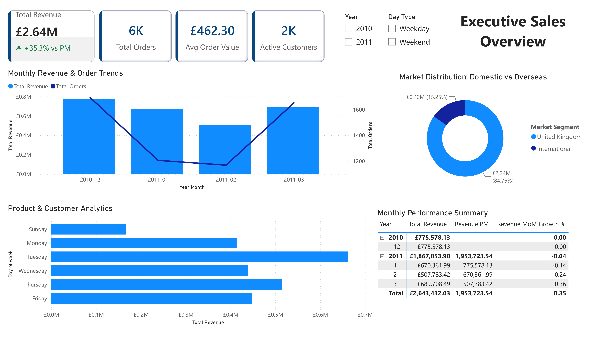

# Online Retail Data Pipeline & Analytics

An end-to-end data engineering and analytics project that simulates a retail data platform, from raw data ingestion to data warehousing and business intelligence reporting.

The project uses Python, MySQL, PySpark, PostgreSQL, Apache Airflow, and Power BI to build an orchestrated ETL workflow.

## Dashboard Preview



*Power BI dashboard — Sales Performance & Trends*

## Architecture

```text
Online Retail.xlsx
       |
       v
Python / Pandas
Excel → Parquet
       |
       v
MySQL (OLTP)
       |
       v
PySpark ETL
       |
       v
PostgreSQL (OLAP)
  ├── Warehouse
  └── Data Mart
       |
       v
Apache Airflow
(Workflow Orchestration)
       |
       v
Power BI Dashboard
```

**Note:** Excel-to-MySQL ingestion is executed separately. Airflow currently orchestrates the MySQL-to-PostgreSQL transformation and data mart refresh.

## Technology Stack

| Component | Technology |
|---|---|
| Data Processing | Python, Pandas, PySpark |
| Storage Format | Parquet |
| Source Database | MySQL 8.0 |
| Data Warehouse | PostgreSQL 16 |
| Orchestration | Apache Airflow 2.8.1 |
| Containerization | Docker, Docker Compose |
| Business Intelligence | Power BI |
| Connectivity | JDBC, ODBC |

## Dataset

**Source:** [UCI Online Retail Dataset](https://archive.ics.uci.edu/dataset/352/online%2Bretail)

- 541,909 original transaction records
- UK-based online retail business
- December 2010 – December 2011
- Includes transaction, product, customer, and country information

## Key Features

- **Data Ingestion:** Convert Excel data into Parquet and load transactions into MySQL.
- **ETL Processing:** Use PySpark to clean, standardize, classify, and transform retail transactions.
- **Data Warehousing:** Build a PostgreSQL warehouse and dimensional data mart.
- **Workflow Orchestration:** Use Apache Airflow to orchestrate downstream ETL and mart refresh tasks.
- **Business Intelligence:** Develop Power BI reports for sales performance, customer behavior, and product analysis.

## Project Structure

```text
├── dags/           # Airflow DAGs
├── src/            # Python and PySpark scripts
├── sql/            # Database migrations and transformations
├── data/           # Local raw and intermediate data
├── bi/             # Power BI reports
├── Dockerfile
├── docker-compose.yml
├── requirements.txt
└── README.md
```

## Current Scope

- Local Docker-based environment.
- Airflow DAG is manually triggered.
- Warehouse and data mart currently use full-refresh loading.
- Monthly source ingestion can simulate data arrival.
- Incremental loading and automated scheduling are planned improvements.

This is a personal portfolio project demonstrating data engineering, data warehousing, workflow orchestration, and business intelligence skills.

**Detailed documentation:** [Technical Documentation](docs/TECHNICAL_DOCUMENTATION.md)